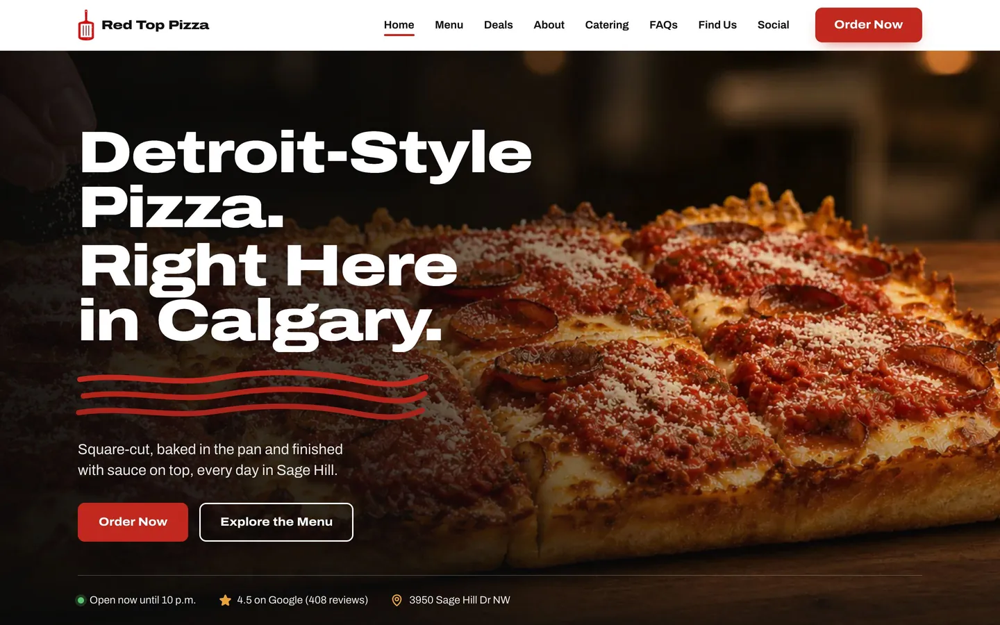
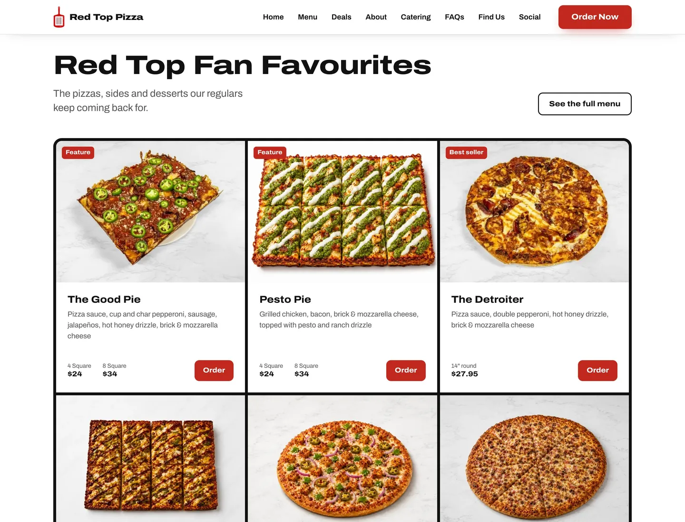
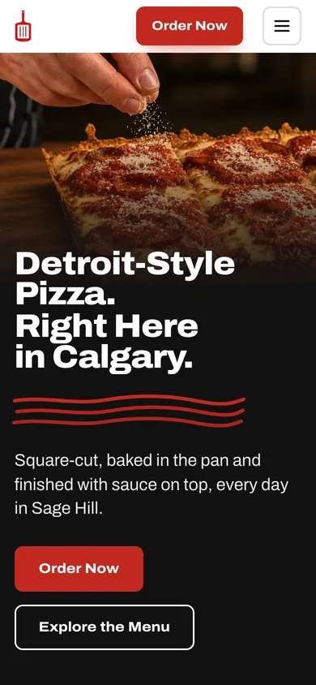

# Red Top Pizza — Website

**Live site: [redtoppizza.ca](https://www.redtoppizza.ca)**

The official website for **Red Top Pizza**, a Detroit-style pizzeria in Sage Hill, Calgary. I built it for the business to replace its old site with something faster, easier to use on a phone, and easier to keep up to date. It gives customers the full menu, deals, catering requests, hours and a one-tap way to order. Working directly with a real business on it also grew my business skills: turning the owner's goals into features, writing for customers, and shipping changes without disrupting a live store.



| Fan favourites | Mobile |
| --- | --- |
|  |  |

## Built with

- **HTML5, CSS3 and vanilla JavaScript (ES2020+)**: no frameworks, no build step, no dependencies
- **CSS custom properties** as a small design system (colour, type scale, spacing, radius, motion tokens)
- **Browser APIs:** IntersectionObserver, View Transitions, `<dialog>`, `Intl.DateTimeFormat`, Clipboard
- **Responsive, mobile-first layout** with CSS Grid and Flexbox
- **SEO:** JSON-LD structured data (Restaurant schema), Open Graph tags, 301 redirects for old URLs
- **Python** for a small local preview server and the image processing pipeline (Pillow → WebP)

## Features

- **Data-driven content.** The menu, prices, hours, deals and featured items all live in one file, [`site/assets/js/data.js`](site/assets/js/data.js), and every page renders from it. Updating a price is a one-line change.
- **Full menu page** with category tabs that follow you as you scroll, and live search with an empty state.
- **Live open/closed status**, computed in Calgary's time zone, so it's correct for every visitor wherever they are.
- **Catering quote form** with inline validation and an accessible error summary.
- **Order popup** that sends customers to pickup or delivery in one tap from any page.
- **Motion design:** a sauce-stripe headline animation, image "wipe" reveals and row-by-row card reveals on scroll, plus page transitions. All of it is turned off for visitors who prefer reduced motion.
- **Accessibility (WCAG 2.2 AA target):** semantic HTML, skip link, full keyboard support, visible focus, tested colour contrast, labelled controls and screen-reader announcements.
- **Performance:** responsive WebP images with `srcset`, lazy loading, and image prefetching just before images scroll into view. The whole site is about 3.5 MB.

## Project structure

```
site/
├── index.html            Home: hero, best seller, fan favourites, deals, about,
│                         catering, reviews, FAQ, find us, social
├── menu.html             Full menu with tabs and search
├── privacy.html
├── accessibility.html
└── assets/
    ├── css/styles.css    Design tokens, layout, components, motion
    ├── js/data.js        All business content (menu, prices, hours, deals)
    ├── js/main.js        Shared behaviour and rendering
    ├── js/menu.js        Menu page rendering, tabs and search
    └── img/              WebP photos, icons (SVG sprite), logo
```

## How it works

Content is plain data, and the UI is rendered from it:

```js
// data.js: the featured section is just a list
favourites: [
  { pizza: "good-pie", sizes: ["sq4", "sq8"] },
  { pizza: "detroiter", sizes: ["r14"], img: "detroiter-14" },
  { item: "Classic Calzone" },
],
```

```js
// main.js: each entry becomes a card
featured.innerHTML = D.favourites.map((f) => {
  if (f.pizza) {
    const p = D.pizzas.find((x) => x.id === f.pizza);
    const sizes = (f.sizes || ["sq4", "sq8"]).filter((k) => p.prices[k] != null);
    return card({ name: p.name, img: f.img || p.img, desc: f.desc || p.desc, /* ... */ });
  }
  const it = allItems.find((x) => x.name === f.item);
  return card({ name: it.name, img: it.img, desc: it.desc, /* ... */ });
}).join("");
```

The look is driven by a few design tokens, so a theme change touches only a few lines:

```css
:root {
  --sauce: #c1281e;   /* brand red: primary actions */
  --black: #111111;   /* dark sections and text (18.9:1 contrast on white) */
  --ink-2: #555555;   /* secondary text (7.5:1 on white) */
  --r-pan: 18px;      /* card radius */
}
```

## Challenges solved

**Images appearing late after their reveal animation.** Photos are masked with `clip-path` until they scroll in. Browsers treat a masked lazy image as off-screen, so the download only started when the animation did, and the photo popped in after it finished. I fixed it in two parts. An IntersectionObserver prefetches each image about one screen early. Each reveal then waits for the image to load and decode, with a 3-second fallback so content can never stay hidden:

```js
Promise.race([photoReady(img), new Promise((r) => setTimeout(r, 3000))])
  .then(() => requestAnimationFrame(() => show(el)));
```

**Observers that never fired.** A card masked by its own `clip-path` counts as not intersecting, so cards never revealed. I split each card into an unmasked outer slot, which the observer watches, and an inner layer that animates.

**Stale CSS after a redesign.** Phones loaded the new HTML with the old cached stylesheet, so the page looked broken. I added versioned asset URLs (`styles.css?v=9`) so every change gets a new address. The local preview server also sends `Cache-Control: no-store`.

**iPhone-only layout bugs.** Safari on iOS gives date inputs a minimum width, which pushed the field out of the form card. A price grid with five items in three columns also left broken divider lines. I fixed the input with `appearance: none` and `min-width: 0`. I rebuilt the grid with 1px gaps over a line-coloured background, so the dividers always join, and a 6-column layout on phones (squares on one row, rounds on the next). I verified both in an iPhone simulator.

**Replacing a live site without downtime.** I tested the new site on a private preview, switched it over outside peak hours with a rollback ready, and added 301 redirects so old links and search results still land on the right section. I also made sure the new pages were listed in the sitemap for search engines.

**Accurate opening hours for every visitor.** "Open now" is calculated in America/Edmonton time with `Intl.DateTimeFormat().formatToParts()`, not the visitor's own clock.

## Run it locally

```bash
python3 preview-server.py
```

Then open http://localhost:8765. The site is static, so any static file server pointed at `site/` also works.

## Credits

Built for Red Top Pizza, Calgary. Menu photos and brand assets belong to Red Top Pizza.
